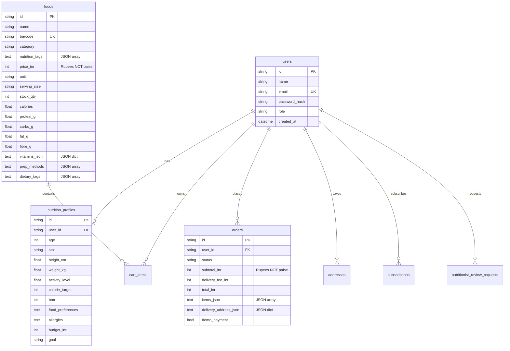

# NUTRIVERSE CODEBASE AUDIT & TECHNICAL GAP ANALYSIS
**Date:** October 11, 2026  
**Auditor:** Senior Full-Stack Engineer & Technical Lead  
**Scope:** Current codebase (`backend/app/main.py`, `app/page.tsx`, `components/`, `lib/api.ts`, `backend/tests/test_api.py`) vs. Production Quick-Commerce Master Specification.

---

## 1. Executive Summary & Audit Verdict

The current Nutriverse repository is a working prototype with a Next.js 14 frontend and a FastAPI backend communicating over REST with SQLite. While the user-facing interface looks aligned with the brand design system and 12 unit tests pass in pytest, **the codebase is currently structured as an unversioned single-page prototype rather than a production-ready quick-commerce application.**

### Critical Architectural Deficiencies Identified:
1. **Single-Page Tab Switcher vs. Real Routing:** The Next.js frontend has zero App Router subroutes. All navigation is state-based (`activeTab = "storefront" | "explorer" | ...`). Deep links (`/explore`, `/food/[id]`, `/p/[barcode]`, `/orders/[id]`) and browser history (back/forward) do not work.
2. **Simulated Authentication & High-Risk Defaults:** Every unauthenticated visitor is automatically logged in as a demo user (`alex@nutriverse.local`). JWT tokens are stored in `localStorage` without refresh tokens or HttpOnly cookies. Hardcoded seed passwords and 1-click role-switching shortcuts run unconditionally without checking `APP_ENV=development`.
3. **Monetary Integrity (INR vs. Paise):** Prices are stored as integer Rupees (`price_inr = 199`) instead of integer paise (`19900`). This is incompatible with Razorpay, standard Indian payment gateways, and fractional tax/delivery calculations.
4. **Relational Normalization & Heavy JSON Column Anti-Pattern:** Core commerce and nutrition entities (`categories`, `nutrition_tags`, `order_items`, `calin_pack_items`, `addresses`, `allergens`, `delivery_zones`) do not exist as relational tables. Instead, JSON text strings are dumped into `foods.nutrition_tags`, `orders.items_json`, and `calin_pack_tiers.items_json`.
5. **No Database Migrations:** Alembic is not installed or configured. Schema is created imperatively via `Base.metadata.create_all(engine)` on startup.
6. **Rule-Based Mock AI vs. Tool-Calling LLM:** `/api/ai/chat` is a Python `if "iron" in q.lower():` string matcher rather than a tool-calling Claude integration.
7. **Zero Frontend Automated Tests:** No Playwright e2e test suite exists.
8. **Health Claim & Nutrition Guardrails:** Lacks ICMR-NIN RDA 2020 reference tables, safety floors (<1200 kcal for women / <1500 kcal for men), and guardrails for minors, pregnancy, or declared medical conditions.

---

## 2. Current Architecture Map

### 2.1 Backend Endpoints (`backend/app/main.py`)

| Domain | Method & Path | Auth / Role | Current Implementation | Gap / Vulnerability |
| :--- | :--- | :--- | :--- | :--- |
| **System** | `GET /health` | Public | Returns `{"status": "ok"}` | No DB connectivity check |
| **System** | `GET /ready` | Public | Runs `select(User.id).limit(1)` | Basic query; no pool health check |
| **Auth** | `POST /api/auth/register` | Public | Creates user, PBKDF2 hash, returns JWT | No password complexity, no email verification, no rate limit |
| **Auth** | `POST /api/auth/login` | Public | Verifies PBKDF2, returns 120-min JWT | No refresh token, no brute-force rate limit |
| **Auth** | `GET /api/auth/me` | Bearer JWT | Returns current user profile | No session revocation mechanism |
| **Profile** | `POST /api/profile` | Bearer JWT | Computes Mifflin–St Jeor BMR & TDEE | Lacks safety floors, guardrails for minors/pregnancy, ICMR RDA |
| **Profile** | `GET /api/profile` | Bearer JWT | Returns stored user nutrition profile | Incomplete dietary preference taxonomy |
| **Catalog** | `GET /api/foods` | Public | Filter by search query, tag, sort | Queries JSON string in text column; slow at scale |
| **Catalog** | `GET /api/foods/{food_id}` | Public | Returns single food item | Lacks FSSAI, allergens, and ICMR RDA coverage |
| **Catalog** | `GET /api/foods/barcode/{barcode}` | Public | Lookup by EAN barcode | Indexed on `barcode`, but returns single food only |
| **Categories**| `GET /api/categories` | Public | Returns distinct categories & hardcoded tags | Not backed by normalized tables |
| **Recipes** | `GET /api/recipes` | Public | Lists recipes | Ingredients stored as JSON string |
| **Recipes** | `GET /api/recipes/{recipe_id}` | Public | Returns recipe detail | Ingredients not foreign-keyed to foods table |
| **Plate** | `POST /api/combinations/calculate` | Public | Calculates combined nutrition & price | Calculates in Rupees, not paise |
| **Calin Packs**| `GET /api/packs` | Public | Lists 3 tiers (Basic, Minimal Plus, Premium) | Packs are hardcoded seed rows with JSON items |
| **Calin Packs**| `GET /api/packs/{tier}` | Public | Gets single tier | Items stored as JSON string |
| **Calin Packs**| `POST /api/packs/customize` | Public | Recalculates pack price & macros | Arbitrary 15% discount formula; no generator engine |
| **Cart** | `GET /api/cart` | Bearer JWT | Itemized cart for user | Stored in Rupees; free delivery above ₹800 hardcoded |
| **Cart** | `POST /api/cart/items` | Bearer JWT | Add food or pack to cart | No atomic stock reservation |
| **Cart** | `DELETE /api/cart/items/{id}` | Bearer JWT | Remove item from cart | Functional |
| **Checkout**| `POST /api/orders/checkout` | Bearer JWT | Deducts stock, creates order | Ignores `Address` table; saves raw JSON; demo only |
| **Orders** | `GET /api/orders` | Bearer JWT | Returns user orders (or all if admin) | Items unpacked from JSON string |
| **Orders** | `GET /api/orders/{order_id}` | Bearer JWT | Returns order details | Items unpacked from JSON string |
| **Subs** | `GET /api/subscriptions` | Bearer JWT | Lists user subscriptions | Functional prototype |
| **Subs** | `POST /api/subscriptions` | Bearer JWT | Creates recurring pack subscription | No recurring payment tokenization |
| **Subs** | `PUT /api/subscriptions/{id}/status` | Bearer JWT | Pause / Resume / Cancel | Functional |
| **Reviews** | `POST /api/nutritionist/requests` | Bearer JWT | User submits pack review request | Functional |
| **Reviews** | `GET /api/nutritionist/requests` | Bearer JWT | Nutritionist/admin views queue | Functional |
| **Reviews** | `POST /api/nutritionist/requests/{id}/review` | Role: `nutritionist`/`admin` | Nutritionist records advice | Functional |
| **AI** | `POST /api/ai/chat` | Bearer JWT | String-matching response generator | Hardcoded `if/elif` branches; no real LLM or tool-calling |
| **Admin** | `GET /api/admin/stats` | Role: `admin` | Counts, stock <= 40, recent orders | Unindexed queries; no real metrics |
| **Admin** | `PUT /api/admin/orders/{id}/status` | Role: `admin` | Advances status (`placed` -> `delivered`) | Lacks courier/delivery slot integration |
| **Admin** | `POST /api/admin/foods` | Role: `admin` | Creates food item | Inserts JSON strings for tags/prep |

---

### 2.2 Frontend Architecture & Component Map

Current Routing: **Monolithic Single Page Application** in `app/page.tsx` controlled by `activeTab` React state.

```
app/
├── layout.tsx         # Root HTML layout with Google Fonts
├── globals.css        # Vanilla CSS Brand Design System + Utility Polyfills
└── page.tsx           # Monolithic tab container with auto-demo login
```

#### View Components (`components/`):
- `AppHeader.tsx`: Navigation bar with tab buttons, active tab pill, role indicator, cart count.
- `StorefrontView.tsx`: Landing showcase with hero, 5 pillars, and Calin pack cards.
- `FoodExplorerView.tsx`: Catalog with multi-nutrient filter buttons and category dropdown.
- `FoodDetailModal.tsx`: Product detail modal with macro breakdown and Add to Bag.
- `CalinPacksView.tsx`: Calin packs tier selection, customization engine, and subscription trigger.
- `ScannerView.tsx`: HTML5 camera scanner and manual EAN-13 input with test barcodes.
- `RecipesView.tsx`: Recipes cards with preparation methods and "Add Ingredients to Bag".
- `CombinationsView.tsx`: Interactive plate builder with live sum calculation.
- `OnboardingModal.tsx`: Mifflin–St Jeor intake calculator with physical metrics inputs.
- `CartDrawer.tsx`: Slide-out bag with itemized summary, demo address form, and checkout button.
- `CustomerDashboardView.tsx`: Member Hub with intake summary, order history, and active subscriptions.
- `AdminPortalView.tsx`: Operations console with fulfillment dropdown and nutritionist queue.
- `AssistantDrawer.tsx`: Slide-out AI assistant interface.
- `AuthModal.tsx`: Sign in, registration, and 1-click test role switchers.

#### Dead / Legacy Components (Leftover from static landing phase):
- `Hero.tsx`, `Navbar.tsx`, `Problem.tsx`, `Solution.tsx`, `HowItWorks.tsx`, `CalinPacks.tsx`, `Benefits.tsx`, `AppPreview.tsx`, `Mission.tsx`, `CtaSection.tsx`, `ContactAndFooter.tsx`, `InteractiveCalculatorModal.tsx`, `PackDetailModal.tsx`.
*Recommendation:* Archive or remove these dead files during Phase 1 cleanup to prevent confusion.

---

### 2.3 Data Models (`backend/app/main.py`)



---

## 3. Deep Dive Findings

### 3.1 Routing & Deep Linking (Frontend)
- **Status:** FAIL.
- **Details:** The app is a single-page tab switcher (`activeTab` state in `app/page.tsx`). There are no App Router routes (`/explore`, `/food/[id]`, `/p/[barcode]`, `/packs`, `/packs/[tier]`, `/cart`, `/checkout`, `/account`, `/orders`, `/orders/[id]`, `/admin/*`, `/nutritionist/*`).
- **Consequences:**
  - Scanning a QR code on physical packaging cannot deep-link to `/p/[barcode]`.
  - Refreshing the page or using the browser back button loses the user's place.
  - Sharing links to specific food items or recipes is impossible.

### 3.2 Authentication & Simulation Analysis
- **Status:** HIGH RISK / SIMULATED.
- **Details:**
  1. **Auto-Login Bypass (`app/page.tsx:86-107`):** When anyone opens the site without a token, the frontend silently calls `/api/auth/login` with hardcoded credentials for `alex@nutriverse.local` and stores the resulting JWT. The app cannot be experienced as a true guest.
  2. **1-Click Hardcoded Logins (`components/AuthModal.tsx:64-94`):** Buttons for Alex, Dr. Priya, and Store Admin execute login using hardcoded email and password strings embedded directly in the frontend bundle.
  3. **Hardcoded Database Seed (`backend/app/main.py:440-466`):** On startup, `seed_initial_data()` creates three test accounts with hardcoded passwords (`Customer123!`, `Nutritionist123!`, `AdminPass123!`). There is no environment guard checking `APP_ENV == "development"`.
  4. **Token Security:** Tokens are stored in browser `localStorage`. No HttpOnly cookie is set. No refresh token flow exists. JWT expiration is a static 120 minutes.
  5. **Password Security:** Password hashing uses `pbkdf2_sha256` instead of `bcrypt`. Password validation only checks length $\ge 8$, allowing weak passwords like `password` or `12345678`.

### 3.3 Monetary Units & Currency Precision
- **Status:** FAIL.
- **Details:**
  - All price fields in the database are integers representing **whole Indian Rupees** (`price_inr`, `base_price_inr`, `subtotal_inr`, `delivery_fee_inr`, `total_inr`).
  - Standard payment gateways (Razorpay, Stripe) and quick-commerce platforms require **integer paise** (1 INR = 100 paise) to handle exact calculations, GST, platform fees, and coupon discounts without rounding errors.
  - No GST tax calculation or line-item tax breakdown exists.

### 3.4 Data Model Normalization vs. JSON Anti-Pattern
- **Status:** HIGH TECHNICAL DEBT.
- **Details:**
  - `Food.nutrition_tags`: Stored as `json.dumps(["protein_rich", "iron_rich"])`. Filtering requires JSON deserialization in Python memory or slow `LIKE '%tag%'` queries.
  - `Order.items_json`: Order items are serialized as JSON strings in the order row. There is no `order_items` table with historical price/nutrient snapshots, making order reporting and inventory reconciliation difficult.
  - `Order.delivery_address_json`: Address is serialized as JSON in the order row. The existing `Address` table is completely bypassed.
  - Missing entities required for a Blinkit-style grocery platform:
    - `categories` (hierarchical grocery categories)
    - `nutrition_tags` (many-to-many relationship with foods)
    - `delivery_zones` (pincodes, serviceability, minimum order, delivery fees)
    - `delivery_slots` (time windows, capacity)
    - `payments` (order ID, gateway, payment status, transaction reference)
    - `inventory_movements` (stock reservation, deduction, returns)
    - `allergens` & `food_allergens`
    - `nutrient_reference` (ICMR-NIN RDA 2020 reference data)
    - `product_labels` (FSSAI license, batch number, shelf life, storage)

### 3.5 Database Migrations & Database Engine
- **Status:** FAIL.
- **Details:**
  - Alembic is neither installed in `backend/requirements.txt` nor initialized in the project.
  - Tables are created via `Base.metadata.create_all(engine)` in `main.py:229`. Altering any model breaks existing databases.
  - The application defaults to SQLite (`sqlite:///./nutriverse.db`). PostgreSQL is referenced in `docker-compose.yml`, but `psycopg2` / `psycopg` is not in `backend/requirements.txt`.

### 3.6 Nutrition Engine & Scientific Rigor
- **Status:** PARTIAL / LACKS GUARDRAILS.
- **Details:**
  - BMR calculation correctly uses the Mifflin–St Jeor equation in `main.py:976`.
  - TDEE correctly multiplies BMR by activity multipliers ($1.2$ to $1.9$).
  - **Missing Elements:**
    1. No safety floors: Does not prevent recommendations below 1,200 kcal/day (women) or 1,500 kcal/day (men).
    2. No guardrails: Allows minors (<18), pregnant/lactating women, and individuals with declared conditions to generate computed diet plans without age-appropriate warnings or medical disclaimers.
    3. Lacks ICMR-NIN RDA 2020 reference tables: Cannot calculate micronutrient coverage % (Iron, Calcium, Vitamin C, Vitamin A, Folate, Zinc).
    4. Health claims: Some components reference "cellular longevity" or "clinical triage" instead of compliant "nutritionist review" and "estimated guidance" terminology.

### 3.7 AI Assistant ("Nourish") Implementation
- **Status:** MOCK / SIMULATED.
- **Details:**
  - `POST /api/ai/chat` in `main.py:1701` inspects user input using primitive substring checks:
    ```python
    if "iron" in q_lower: ...
    elif "protein" in q_lower: ...
    elif "calin pack" in q_lower: ...
    ```
  - It does NOT connect to Claude or any LLM.
  - It does not use function/tool-calling over DB tools (`search_foods`, `get_food`, `get_recipe`, `get_user_targets`, `build_basket_summary`).
  - It lacks prompt-injection resistance, per-user rate limiting, and conversational context retention.

### 3.8 Security & Reliability
- **Status:** HIGH RISK.
- **Details:**
  1. **Rate Limiting:** None. No protection against credential stuffing, checkout flooding, or AI endpoint exhaustion.
  2. **CORS:** Parses comma-separated `ALLOWED_ORIGINS` from env, but lacks origin regex validation or strict production defaults.
  3. **Error Handling:** Returns default FastAPI tracebacks without structured logging or request correlation IDs.
  4. **Health Check:** `/health` does not verify database connectivity; `/ready` only runs a simple query without connection pooling checks.
  5. **Secrets:** Default JWT secret in code (`change-this-in-production-long-secure-key`).

### 3.9 Test Coverage & Verification Integrity
- **Status:** PARTIAL (Backend Only).
- **Backend Tests:** 12 tests in `backend/tests/test_api.py` run against SQLite and pass.
- **Untested Areas:**
  - Pincode serviceability & delivery slot assignment.
  - Razorpay webhook verification and payment idempotency.
  - Concurrent checkout inventory reservation.
  - Multi-tier Calin Pack generator satisfying hard allergen constraints and $\ge 90\%$ calorie coverage.
  - Token refresh, cookie rotation, and unauthorized role access.
- **Frontend Tests:** **Zero.** No Playwright, Jest, or Vitest tests exist. There is no `npm run test:e2e` script.

---

## 4. Prioritized Gap List vs. Master Specification

```mermaid
gantt
    title Nutriverse Upgrade Roadmap
    dateFormat  X
    axisFormat Phase %d
    section Foundation
    Phase 1 : Hardening & Routing       :active, p1, 0, 1
    Phase 2 : Data Model & Migrations   :p2, 1, 2
    section Core Intelligence
    Phase 3 : Scientific Nutrition Engine :p3, 2, 3
    Phase 4 : Catalog & Scanner         :p4, 3, 4
    Phase 5 : Calin Pack Generator      :p5, 4, 5
    section Commerce & AI
    Phase 6 : Blinkit Commerce Flow     :p6, 5, 6
    Phase 7 : Tool-Calling Claude AI    :p7, 6, 7
    Phase 8 : Admin & Nutritionist      :p8, 7, 8
    section Delivery
    Phase 9 : QA, Playwright & Deploy   :p9, 8, 9
```

### Prioritized Gap Breakdown:

1. **Phase 1 — Foundation Hardening**
   - Implement real Next.js App Router pages: `/`, `/explore`, `/food/[id]`, `/p/[barcode]`, `/packs`, `/packs/[tier]`, `/recipes`, `/cart`, `/checkout`, `/account`, `/orders`, `/orders/[id]`, `/admin/*`, `/nutritionist/*`.
   - Implement real auth: Short-lived access JWT + HttpOnly refresh token cookie, bcrypt hashing, password policy, role guards.
   - Restrict seed passwords and 1-click test role logins to `APP_ENV=development`.
   - Remove auto-login from `page.tsx`.
   - Setup Alembic migrations with PostgreSQL driver (`psycopg`).
   - Convert all prices to integer paise. Add database indexes.
   - Install and configure Playwright (`npm run test:e2e`). Add rate limiting (slowapi) and structured logging.

2. **Phase 2 — Data Model Upgrade**
   - Normalize `addresses`, `delivery_zones`, `delivery_slots`, `order_items`, `payments`, `inventory_movements`, `categories`, `nutrition_tags`, `allergens`, `food_allergens`, `nutrient_reference` (ICMR-NIN RDA 2020), `calin_pack_items`, `product_labels`.
   - Write Alembic migrations ensuring existing data is preserved.

3. **Phase 3 — Nutrition Engine**
   - Build `backend/app/nutrition/` pure module with Mifflin–St Jeor BMR, TDEE multipliers, goal adjustments with safety floors (>1200 kcal women / >1500 kcal men).
   - Integrate ICMR-NIN RDA 2020 macro & micronutrient reference values.
   - Implement mandatory safety guardrails for minors, pregnancy, and declared medical conditions.
   - Implement `coverage(basket, profile)` function.
   - Unit test with worked reference cases (e.g., 30M, 75kg, 175cm, moderate activity $\rightarrow$ BMR 1,698.75, TDEE 2,633 kcal).

4. **Phase 4 — Catalog, Search & Scanner**
   - Seed 150+ authentic Indian food items (IFCT 2017 / USDA) with FSSAI tags, storage, and preparation methods.
   - Implement 4 nutritional shelves (carbs, proteins, healthy fats, vitamins & minerals).
   - Full-text search with typo tolerance and nutrient/budget filters.
   - Scanner with optical camera, manual EAN-13 entry, printable QR label generator for admins, deep-linking to `/p/[barcode]`.

5. **Phase 5 — Calin Packs Engine**
   - Build pack generator: maps calorie/macro targets, duration (1, 3, 7 days), budget, and tier to concrete in-stock baskets.
   - Enforce hard allergen constraints.
   - Build substitution engine maintaining equal-or-better nutrient coverage.
   - Implement subscription state transitions and nutritionist review requests.

6. **Phase 6 — Commerce Flow (Blinkit-Style)**
   - Pincode serviceability check for Vijayawada pilot (e.g. 520001–520015).
   - Delivery slot selection and capacity tracking.
   - Razorpay test integration (UPI, Cards) + Cash on Delivery; signature verification webhooks.
   - Atomic inventory reservation at checkout with release on cancellation.
   - Order lifecycle tracking with live updates.

7. **Phase 7 — AI Assistant ("Nourish")**
   - Connect Anthropic Claude API using tool-calling over DB tools (`search_foods`, `get_food`, `get_recipe`, `get_user_targets`, `build_basket_summary`).
   - Implement system prompt guardrails (no medical diagnosis/treatment, disclaimers, allergy compliance, injection protection).
   - Automated tests with mocked LLM tool calls.

8. **Phase 8 — Admin & Nutritionist Portals**
   - Admin: Food CRUD, CSV import, stock management, pack tier config, delivery zones, order pipeline.
   - Nutritionist: Review queue, profile inspection with consent, guidance notes authoring.

9. **Phase 9 — QA, Security, Accessibility & Deploy**
   - Playwright end-to-end tests for the entire customer journey.
   - OWASP security review, accessibility audit (Lighthouse $\ge 85$), Docker production setup.

---

## 5. Audit Conclusion

The application provides a solid UI foundation and a clear architectural direction. By addressing the single-page routing constraint, converting currency to paise, introducing normalized database models with Alembic migrations, and replacing simulated auth and mock AI with production-grade implementations, Nutriverse can successfully launch as a nutrition-first quick-commerce platform in Vijayawada.

**Next Action:** Await user confirmation before proceeding to **PHASE 1 — FOUNDATION HARDENING**.
